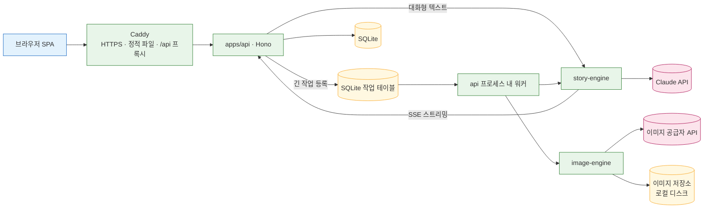
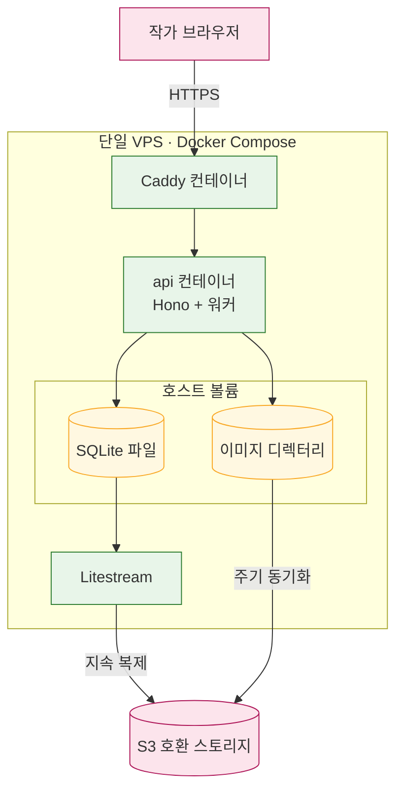

# 02. 아키텍처 — 저장소 구조·런타임·배포

이 문서는 MVP의 코드 구조, 프론트엔드·백엔드 런타임, 인증, AI 작업 실행 방식, 배포 구성을 정리한다. 관련 결정 원본은 [ADR 모노레포](../.forge/adr/261101-230415-typescript-monorepo-web-api-split.md), [ADR 배포](../.forge/adr/261101-232141-single-vps-docker-compose-single-instance.md), [ADR 텍스트 LLM](../.forge/adr/261101-225940-claude-single-provider-thin-interface.md)이다.

## 저장소 구조와 역할

저장소는 **pnpm workspace 기반의 TypeScript 모노레포**다. 화면(apps/web)과 API 서버(apps/api)를 분리하고, 두 엔진과 공용 타입은 packages/ 아래 패키지로 둔다. 모든 패키지가 TypeScript라서 packages/shared의 API 타입·zod 스키마를 web, api, 두 엔진이 코드 생성 없이 그대로 공유한다. Python 백엔드는 이미지 모델을 직접 돌릴 때만 이점이 있는데 MVP는 호스팅된 이미지 API를 호출하므로 쓰지 않는다.

| 경로 | 내용 | 담당 역할 |
|---|---|---|
| `apps/web` | 집필 화면 SPA(작품 목록, 회차 에디터, 설정 화면, 이미지 갤러리, 자료 화면) | frontend |
| `apps/api` | Hono API 서버, 인증, CRUD, 작업 테이블과 워커, 이미지 저장소 | backend |
| `packages/shared` | API 요청·응답 타입과 zod 스키마, 공용 상수 | backend |
| `packages/story-engine` | 텍스트 생성 파이프라인(컨텍스트 조립, Claude 호출, 설정 충돌 검사, 자료 조사) | story |
| `packages/image-engine` | 이미지 프롬프트 조립, 이미지 공급자 호출, 대표 이미지 참조 입력 | imagery |
| `tests` | E2E·통합 테스트(별도 qa 워크스페이스에서 실행) | qa |
| `infra`, `.github/workflows` | Docker Compose·Caddy 설정, 백업, CI/CD | deploy |

루트 `package.json`, lockfile, `tsconfig` 같은 공용 설정 파일은 어느 역할의 폴더에도 속하지 않는다. 여러 역할이 동시에 고치면 충돌하므로, 모노레포 골격은 다른 작업보다 먼저 한 번에 순서대로 깐다. 구체 순서는 [08 제작 계획](08-build-plan.md)에 있다.

엔진 패키지는 api 프로세스 안에서 라이브러리로 불린다. 별도 서버로 띄우지 않는다.

## 프론트엔드 — Vite + React SPA

apps/web은 **Vite + React SPA**다. 클라이언트 라우팅을 쓰고, 빌드 결과는 정적 파일이라 Caddy가 그대로 내려준다. Next.js를 쓰지 않는 이유는 다음과 같다.

- 초대제 집필 도구라 SEO가 필요 없다.
- 블록 에디터, ghost text, AI 제안 비교 UI처럼 화면 대부분이 클라이언트 상태다.
- API 서버(apps/api)가 따로 있어 Next.js 서버 기능과 역할이 겹친다.

라우터 라이브러리(TanStack Router 또는 React Router)와 상태 관리 방식은 frontend가 정할 것이다. 에디터 라이브러리 선택은 [06 에디터의 스파이크 절](06-editor-and-ai-ux.md)을 따른다.

## 백엔드 — Hono

apps/api는 **Node 런타임의 Hono**다.

- **zod 검증**: 요청 본문과 응답은 packages/shared의 zod 스키마로 검증한다.
- **SSE 스트리밍**: 대화형 AI 기능의 결과를 Server-Sent Events로 흘려보낸다.
- **RPC 타입 공유**: Hono RPC 클라이언트를 쓰면 apps/web이 코드 생성 없이 api의 요청·응답 타입을 그대로 받는다.

NestJS는 모듈·DI 구조가 소규모 MVP에 과해서, Fastify는 web과의 타입 공유를 별도 도구로 맞춰야 해서 택하지 않았다. 엔드포인트 목록과 경로 설계는 backend가 정할 것이다.

## 인증과 초대

- 로그인은 **이메일 + 비밀번호**다.
- 가입은 **관리자가 발급한 초대 코드**가 있어야만 할 수 있다. 공개 가입은 없다.
- 비밀번호 해시와 세션 관리는 직접 구현하지 않고 **검증된 인증 라이브러리**를 쓴다. 어떤 라이브러리를 쓸지는 backend가 정할 것이다(Hono와 연동 예제가 있는 라이브러리를 우선 검토).
- MVP에서 **비밀번호 재설정은 관리자가 처리**한다. 메일 발송 기능은 없다. 그래서 메일 발송 서비스(SMTP 등)에 의존하지 않는다.
- 모든 작품·회차·설정·자료·이미지 조회는 요청한 작가가 소유자인지 확인한다. 작가는 자기 작품만 다룬다.

초대 코드로 가입하는 흐름은 짧은 선형 절차다.

```
관리자 초대 코드 발급 → 작가가 코드·이메일·비밀번호 입력 → 코드 검증 → 계정 생성 → 로그인
                                              ↓ 코드 무효·사용됨
                                          가입 거절
```

## AI 비용 부담

AI API 비용(텍스트 LLM, 이미지 생성, 웹 검색)은 **서비스 키로 운영자가 부담**한다. 작가 개인 키를 입력받는 방식(BYOK)은 두지 않는다. 작가가 공급자 키를 2~3개 발급해야 하는 가입 마찰과, 서버의 키 암호화 저장 부담을 피하기 위해서다.

앱 안에는 작가별 사용량 한도가 없다. 대신 모든 AI 호출을 기록하고([03 데이터 모델의 AI 사용 기록](03-data-model.md#ai-사용-기록)) 운영자가 그 기록을 보고 관리한다. 앱 밖의 안전장치로 **공급자 콘솔의 월 지출 한도**를 설정하는데, 이는 deploy가 맡는 운영 작업이다.

## AI 작업 실행 방식

AI 작업은 성격에 따라 두 경로로 실행한다.

- **대화형 텍스트**(이어쓰기, 다시쓰기, 문체 다듬기, ghost text, 사이드 패널, 자료 조사)는 **요청 안에서 SSE로 스트리밍**한다. 작가가 화면 앞에서 기다리고, 글자가 흘러나오는 것이 곧 UX다.
- **긴 작업**(이미지 생성, 회차 완료 처리 — 회차 요약과 정형 필드 변경 제안)은 **SQLite 작업 테이블**에 넣고 **api 프로세스 안의 워커**가 처리한다. 작가가 화면을 떠나거나 새로고침해도 작업이 끝나고 결과가 남는다. 화면은 작업 상태를 조회해 진행을 보여 준다.
- **Redis 큐(BullMQ 등)는 쓰지 않는다.** 단일 서버·소수 작가 규모에서는 인프라만 늘린다. 작업 테이블도 Drizzle 이식성 규칙을 따르므로 DBMS로 옮길 때 함께 옮겨진다.

요청이 들어와서 어느 경로로 갈지는 기능 종류로 갈린다. 아래 흐름도는 브라우저 요청이 Caddy와 api를 거쳐 스트리밍 경로와 작업 테이블 경로로 나뉘는 모습이다.



긴 작업 하나는 등록부터 결과 확인까지 아래 상태를 거친다. 실패한 작업은 상태와 오류가 테이블에 남아 작가가 다시 요청할 수 있다.

```mermaid
stateDiagram-v2
    [*] --> 대기: api가 작업 등록
    대기 --> 실행중: 워커가 집어 감
    실행중 --> 완료: 결과 저장
    실행중 --> 실패: 공급자 오류·검열 차단
    실패 --> 대기: 작가가 다시 요청
    완료 --> [*]

    classDef ok fill:#e8f5e9,stroke:#2e7d32
    classDef bad fill:#ffebee,stroke:#c62828
    class 완료 ok
    class 실패 bad
```

재시도 횟수, 워커 동시 처리 수, 작업 테이블의 컬럼은 backend가 정할 것이다.

## 배포 구성

MVP는 **단일 VPS의 Docker Compose**로 배포한다.

- **Caddy**: HTTPS 인증서 자동 발급, apps/web 정적 파일 제공, `/api` 요청을 api 컨테이너로 프록시.
- **api 컨테이너**: Hono 서버와 작업 워커가 한 프로세스에서 돈다.
- **호스트 볼륨**: SQLite 파일과 이미지 디렉터리를 컨테이너 밖 호스트 디스크에 둔다.
- **백업은 MVP 필수**: 원고 전체가 SQLite 파일 하나에 들어 있으므로 **Litestream**으로 SQLite를 S3 호환 스토리지에 지속 복제하고, 이미지 디렉터리는 주기적으로 동기화한다.
- **api는 단일 인스턴스로만 실행한다.** SQLite, 로컬 디스크 이미지 저장소, 프로세스 내 워커가 모두 영속 디스크를 가진 상시 서버 하나를 전제하기 때문이다. 여러 인스턴스로 늘리려면 DBMS·S3 호환 저장소·외부 큐로 먼저 옮겨야 한다. 이 제약은 코드에 드러나지 않으므로 반드시 기억한다.
- 휘발성 디스크의 서버리스형 PaaS는 이 전제와 충돌해 쓰지 않는다.

운영 작업(deploy 담당): 공급자 콘솔 월 지출 한도 설정, Litestream 복제 대상 버킷과 복구 절차 점검. 프로덕션 반영은 qa 통과 확인 후에만 하고, 되돌릴 수 없는 작업은 오케스트레이터 확인을 거친다.

배포된 서비스의 구성 요소 관계는 아래와 같다. 백업 경로만 서버 밖으로 나간다.



VPS 업체, 도메인, 버킷 공급자 선택은 deploy가 정할 것이다.
