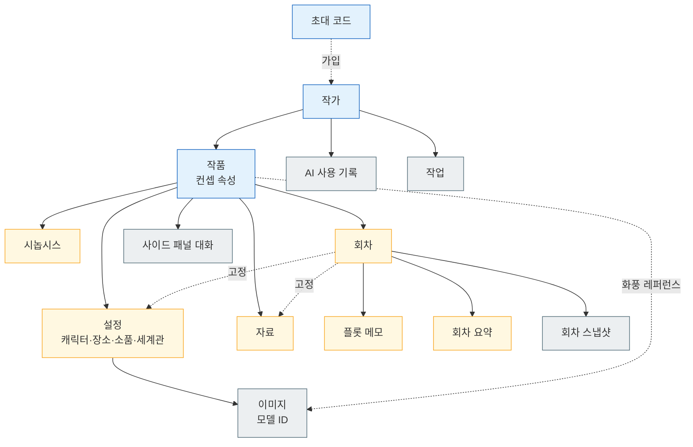

# 03. 데이터 모델 — 엔티티·설정 구조·DB 규칙

이 문서는 MVP가 저장하는 엔티티와 그 관계, 설정의 정형 필드 구조, 그리고 SQLite에서 PostgreSQL 같은 DBMS로 옮길 수 있게 지키는 DB 규칙을 정리한다. 관련 결정 원본은 [ADR 설정 구조](../.forge/adr/261101-223930-setting-structured-fields-plus-free-body.md)와 [ADR DB 접근층](../.forge/adr/261101-231535-drizzle-sqlite-with-portability-rules.md)이다.

이 문서는 **엔티티와 관계, 그리고 결정된 필드**까지만 정한다. 컬럼 타입, 인덱스, 테이블 이름 규칙, 마이그레이션 파일 구성은 backend가 정할 것이다.

## 엔티티 목록

| 엔티티 | 설명 | 주요 관계 |
|---|---|---|
| 작가 | 로그인 계정. 이메일과 비밀번호 해시(인증 라이브러리가 관리). | 작품 여러 개를 소유 |
| 초대 코드 | 관리자가 발급하는 가입용 코드. 사용 여부를 기록한다. | 사용되면 작가 한 명과 연결 |
| 작품 | 웹소설 한 편. 컨셉을 작품 속성으로 가진다. | 작가 1명에 속함 |
| 시놉시스 | 작품 전체의 큰 줄거리와 결말 방향. 작품마다 하나. | 작품에 속함 |
| 회차 | 연재 단위 본문. 완료 표시 여부를 가진다. | 작품에 속함, 순서가 있음 |
| 플롯 메모 | 그 회차에서 일어날 일. 회차마다 하나. | 회차에 속함 |
| 회차 요약 | 회차를 완료로 표시할 때 AI가 만들고 작가가 고칠 수 있는 요약. | 회차에 속함 |
| 회차 스냅샷 | 특정 시점의 회차 본문 전체 사본. 시점 복원에 쓴다. | 회차에 속함, 여러 개 |
| 설정 | 캐릭터·장소·소품·세계관 중 하나. 정형 필드 + 설정 본문. | 작품에 속함 |
| 고정 설정 | 회차와 설정의 연결. 본문 언급과 무관하게 그 회차의 AI 컨텍스트에 들어간다. | 회차 ↔ 설정 |
| 자료 | 작가가 저장한 자료 조사 결과. 요약과 출처를 가진다. | 작품에 속함, 회차에 고정 가능 |
| 이미지 | 생성된 이미지 파일의 기록. 생성 모델 ID를 반드시 가진다. | 설정(또는 화풍 프리셋)에 속함 |
| 작업 | 이미지 생성·회차 완료 처리 같은 긴 작업의 상태. | 작가·대상 엔티티를 참조 |
| AI 사용 기록 | 모든 AI 호출의 사용량. | 작가에 속함 |
| 사이드 패널 대화 | 줄거리 구상·자료 조사 대화 기록. 저장만 하고 AI 컨텍스트에는 넣지 않는다. | 작품에 속함 |

엔티티 사이의 소유 관계는 작가 → 작품을 뿌리로 하는 트리에 가깝다. 아래 흐름도는 화살표가 "소유하거나 참조한다"를 뜻하며, 노란색은 AI 컨텍스트 조립에 쓰이는 엔티티다.

## 작품과 컨셉

컨셉은 설정이 아니라 **작품 속성**이다. 작품마다 하나뿐이고, 모든 텍스트·이미지 생성에 항상 들어가기 때문이다.

| 컨셉 항목 | 쓰임 |
|---|---|
| 장르 | 텍스트 생성 컨텍스트 |
| 톤 | 텍스트 생성 컨텍스트 |
| 서술 시점(1인칭/3인칭) | 텍스트 생성 컨텍스트 |
| 타깃 독자 | 텍스트 생성 컨텍스트 |
| 화풍 프리셋 | 이미지 생성 — 그림체 문구 + 화풍 레퍼런스 이미지 1~3장([05 이미지 엔진](05-image-engine.md)) |

## 회차 본문 저장

회차 본문의 저장 원본은 **에디터 라이브러리의 블록 JSON**이다. 저장할 때마다 **일반 텍스트와 Markdown을 파생해 함께 저장**하고, AI 입력과 회차 스냅샷에는 파생본을 쓴다. Markdown을 원본으로 하지 않는 이유는 대기 중인 AI 제안과 블록 메타 정보를 담지 못하기 때문이다. 에디터 라이브러리는 [06 에디터의 스파이크](06-editor-and-ai-ux.md)로 정해지며, 블록 JSON의 구체 형태는 그 결과를 따른다.

설정 본문도 같은 블록 에디터로 쓰므로 같은 저장 규칙을 따른다.

## 설정 — 정형 필드와 설정 본문

설정은 **정형 필드 + 설정 본문**의 혼합 구조다.

- **정형 필드**는 AI가 이미지 프롬프트 생성과 설정 충돌 검사에 그대로 쓰는 소수의 구조화된 값이다. 본문에서 매번 추출하면 호출마다 결과가 흔들리기 때문에 따로 둔다.
- **설정 본문**은 정형 필드에 담기지 않는 서사(과거사, 말투의 뉘앙스, 관계 등)를 블록 에디터로 자유롭게 쓴 부분이다.
- 필드와 본문이 서로 어긋날 수 있다(예: 본문은 "흑발", 필드는 "금발"). 이 불일치는 작가가 요청하는 "설정 점검"에서 찾아 준다([04 스토리 엔진](04-story-engine.md)).

### 설정 종류와 고정 필드

설정 종류는 **캐릭터·장소·소품·세계관 고정 4종**이고, 종류별 정형 필드도 고정이다. 작가가 종류나 필드를 직접 추가하는 기능은 MVP에 없다. 작가가 만든 필드는 AI가 의미를 알 수 없어서 정형 필드를 두는 이유가 사라지기 때문이다. 고정 필드에 맞지 않는 내용은 설정 본문에 쓴다.

| 종류 | 정형 필드 | 이미지 |
|---|---|---|
| 캐릭터 | 이름 · 별칭 · 성별 · 나이대 · 외형 키워드(머리·눈·체형·대표 의상) · 상태(생존/사망/행방불명) · 대표 이미지 | 있음 |
| 장소 | 이름 · 유형 · 시대·분위기 키워드 · 대표 이미지 | 있음(배경) |
| 소품 | 이름 · 소유자(캐릭터 참조) · 외형 키워드 · 대표 이미지 | 있음 |
| 세계관 | 이름 · 규칙 요약 | 없음 |

- **이름·별칭**은 본문 언급을 찾는 기준이 된다. 현재 회차에 이름이나 별칭이 나오면 그 설정 본문이 AI 컨텍스트에 들어간다.
- **상태**는 자동 충돌 경고의 기준이다. 사망·행방불명 캐릭터가 AI 제안에 나오면 경고한다.
- 정형 필드는 **현재 값만** 둔다. 회차 시점별 값은 MVP에 없다.
- **대표 이미지**는 작가가 승인한 기준 이미지를 가리키며, 같은 설정의 모든 이미지 생성에 참조 입력으로 들어간다.

## 자료

자료는 작가가 자료 조사 결과 중 **저장하기로 한 것만** 남긴다. 저장 항목은 제목, 원래 질문, 요약(작가가 고칠 수 있고 AI 초안에는 미검증 표시), 출처 목록(URL·제목·150자 이내 인용·조회 시각), 태그다. 웹 페이지 원문은 저장하지 않는다. 자세한 규칙은 [07 자료 조사](07-research.md)에 있다.

## 이미지

이미지 레코드는 대상 설정(또는 작품의 화풍 레퍼런스), 저장소상의 위치, 대표 이미지 여부, **생성에 쓴 모델 ID**를 가진다. 모델 ID를 반드시 남기는 이유는 공급자가 모델을 은퇴시켰을 때 영향받는 이미지를 찾기 위해서다. 파일 자체는 DB가 아니라 저장소 인터페이스 뒤의 로컬 디스크에 둔다([05 이미지 엔진](05-image-engine.md)). SQLite BLOB으로 넣지 않는다.

## AI 사용 기록

**모든 AI 호출**(텍스트 생성, ghost text, 설정 점검, 회차 완료 처리, 이미지 생성, 웹 검색)을 한 건씩 기록한다.

| 항목 | 내용 |
|---|---|
| 작가 | 호출을 일으킨 작가 |
| 기능 | 이어쓰기, ghost text, 회차 초안, 이미지 생성 등 |
| 모델 | 호출한 모델 ID |
| 사용량 | 텍스트는 토큰 수, 이미지는 장수, 검색은 횟수 |
| 추정 비용 | 공급자 단가로 계산한 추정 금액 |
| 시각 | 호출 시각 |

앱 안에 작가별 사용량 한도는 **두지 않는다**. 운영자가 이 기록을 보고 관리하며, 앱 밖에서는 공급자 콘솔의 월 지출 한도로 폭주를 막는다([02 아키텍처](02-architecture.md#ai-비용-부담)). 단가표를 어디에 둘지는 backend가 정할 것이다.

## DB 접근층과 이식성 규칙

MVP는 **SQLite**로 시작하고, 나중에 **PostgreSQL** 등 DBMS로 옮길 수 있어야 한다. DB 접근층은 **Drizzle ORM**이다. 옮기는 경로만 보면 provider만 바꾸면 되는 Prisma가 더 쉽지만, Prisma는 생성 단계와 별도 엔진 비용을 매일 치르는 반면 이전은 한 번뿐이라 Drizzle을 택했다. 대가로 이전 때 스키마 정의(`sqliteTable` → `pgTable`)를 다시 써야 한다.

이전 비용을 줄이기 위해 아래 규칙을 지킨다.

1. **DB 접근은 apps/api의 저장소 계층으로만** 한다. 엔진·라우트 코드가 직접 쿼리하지 않는다.
2. **SQLite 전용 기능을 쓰지 않는다.** FTS5 전문 검색, JSON1 함수 쿼리 등.
3. **ID는 문자열 ULID/UUID**를 쓴다. 자동 증가 정수를 쓰지 않는다.
4. **시간 값은 한 가지 형식으로 통일**한다(형식 자체는 backend가 정할 것).
5. 작업 테이블도 같은 규칙을 따른다. 그래야 DBMS로 옮길 때 함께 옮겨진다.
