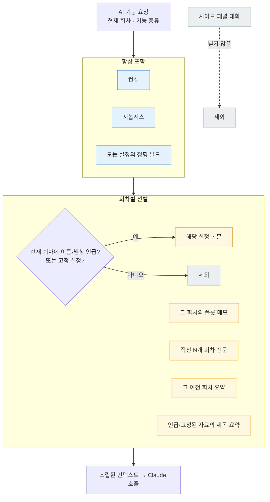
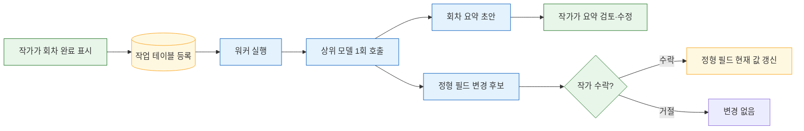

# 04. 스토리 엔진 — 컨텍스트 조립과 텍스트 기능

이 문서는 `packages/story-engine`이 AI에게 무엇을 어떤 규칙으로 넘기는지(컨텍스트 조립), 각 텍스트 기능이 어떻게 동작하는지, ghost text·설정 충돌 검사·회차 완료 처리 규칙을 정리한다. 담당은 story 역할이고, 저장·작업 실행은 backend와 맞물린다. 관련 결정 원본은 [ADR 텍스트 LLM](../.forge/adr/261101-225940-claude-single-provider-thin-interface.md)과 [ADR 설정 구조](../.forge/adr/261101-223930-setting-structured-fields-plus-free-body.md)다.

## 텍스트 LLM 구성

텍스트 생성은 **Claude 단일 공급자**로 시작한다.

- **본 집필**(이어쓰기, 다시쓰기, 문체 다듬기, 회차 초안, 줄거리 구상, 설정 점검, 회차 완료 처리, 자료 조사)은 **상위 모델**을 쓴다.
- **ghost text**는 호출 빈도가 압도적으로 높아서 **빠르고 싼 하위 모델**을 쓴다.
- 공급자 SDK 호출은 **story-engine 안의 얇은 내부 인터페이스**(생성, 스트리밍) 뒤에만 둔다. 나머지 코드는 SDK를 직접 부르지 않는다. 그래서 나중에 공급자를 바꾸거나 추가할 때 고칠 곳이 한 군데다.
- LiteLLM 같은 **다중 공급자 추상화 계층은 쓰지 않는다.** 공급자마다 프롬프트 캐싱, 웹 검색 도구, 구조화 출력 방식이 달라서, 최소공통분모로 추상화하면 긴 설정 컨텍스트 캐싱처럼 일관성 유지에 필요한 기능을 쓰기 어려워진다.
- 이미지 생성은 이와 별개로 다른 공급자를 쓴다([05 이미지 엔진](05-image-engine.md)). Anthropic은 이미지 생성 API를 제공하지 않는다.

상위·하위 모델의 구체 ID, 프롬프트 캐싱 적용 범위는 story가 정할 것이다.

## 컨텍스트 조립 규칙

AI가 글을 쓸 때마다 story-engine은 아래 규칙으로 컨텍스트를 조립한다. 원칙은 **작고 확실한 것은 항상, 크고 상황적인 것은 관련 있을 때만**이다. 정형 필드는 설정 하나에 수십 토큰 정도라 설정이 많아도 전부 넣을 수 있고, 설정 본문·이전 회차 전문은 길어서 선별한다.

| 항목 | 넣는 조건 | 이유 |
|---|---|---|
| 컨셉(장르·톤·서술 시점·타깃 독자) | 항상 | 작품 전체에 항상 적용되는 작품 속성 |
| 시놉시스 | 항상 | 회차 초안이 큰 방향을 벗어나지 않게 |
| 모든 설정의 정형 필드 | 항상 | 작고, AI가 존재하는 캐릭터·장소를 놓치지 않게 |
| 설정 본문 | 현재 회차에 그 설정의 **이름이나 별칭**이 나올 때, 또는 작가가 회차에 지정한 **고정 설정**일 때 | 길어서 전부 넣으면 비용이 커지고 관련 없는 내용이 문체·전개를 오염시킨다 |
| 플롯 메모 | 지금 쓰는 그 회차의 것만 | 이번 회차에서 일어날 일 |
| 직전 회차 전문 | 직전 N개 회차(기본 1~2개) | 문체, 대사 톤, 장면 연속성은 요약으로 전달되지 않는다 |
| 회차 요약 | 직전 N개 회차보다 앞선 회차 전부 | 회차가 100개를 넘겨도 컨텍스트 한계를 넘지 않게 |
| 자료 | 고정되었거나 제목·태그가 회차·플롯 메모에 언급된 것의 제목·요약만, 토큰 상한 안에서 | [07 자료 조사](07-research.md#자료를-집필에-쓰는-규칙) |
| 사이드 패널 대화 | **넣지 않음** | 버린 아이디어가 섞여 있어 AI가 폐기된 전개를 사실로 받아들인다 |

- 설정 본문 선별은 **이름·별칭 문자열 매칭**이다. 같은 입력에 항상 같은 결과가 나와야 일관성 문제를 재현하고 고칠 수 있다.
- **임베딩 기반 의미 검색은 미룬다.** 벡터 저장소가 필요해 "SQLite로 작게"와 맞지 않고, 설정이 수백 개를 넘기 전에는 이득이 작다.
- N 값, 자료 토큰 상한, 전체 컨텍스트 예산은 빌드 단계에서 정한다(story 담당).

조립 순서는 항상 넣는 항목을 먼저 깔고, 회차에 따라 달라지는 항목을 선별해 붙이는 방식이다. 아래 흐름도에서 파란색은 항상 넣는 항목, 노란색은 조건부로 선별하는 항목이다.

## 텍스트 기능별 동작

모든 본문 변경은 **AI 제안**으로 나온다. AI 제안은 작가가 수락하기 전까지 본문에 반영되지 않는다. 화면에서의 비교·수락 방식은 [06 에디터](06-editor-and-ai-ux.md)에 있다.

| 기능 | 부르는 곳 | 입력 | 출력 |
|---|---|---|---|
| 이어쓰기 | "/" 명령(`/이어쓰기`) | 커서 앞 본문 + 조립된 컨텍스트 | 이어지는 블록(AI 제안, 스트리밍) |
| 다시쓰기 | 선택 영역 메뉴 | 선택 영역 + 컨텍스트 | 바꾼 문장(AI 제안) |
| 문체 다듬기 | 선택 영역 메뉴 | 선택 영역 + 컨셉의 톤·서술 시점 | 다듬은 문장(AI 제안) |
| 늘리기·줄이기 | 선택 영역 메뉴 | 선택 영역 + 컨텍스트 | 바꾼 문장(AI 제안) |
| 회차 초안 | "/" 명령(`/초안`) | 그 회차의 플롯 메모 + 컨텍스트 | 회차 초안 블록(AI 제안, 스트리밍) |
| 줄거리 구상 | 사이드 패널 | 작가의 질문 + 시놉시스·설정 | 대화 답변 |
| ghost text | 입력 멈춤 시 자동 | 커서 앞 본문 + 축약 컨텍스트 | 한 문장 이내 제안 |
| 설정 점검 | 작가 요청 | 회차 본문 + 정형 필드 + 관련 설정 본문 | 모순·불일치 목록 |
| 자료 조사 | 사이드 패널 | 작가의 질문 | 출처가 붙은 답변([07 자료 조사](07-research.md)) |

### 줄거리 구상 결과의 행방

줄거리 구상은 사이드 패널에서 대화로 한다. 대화는 저장만 하고 컨텍스트에는 넣지 않는다. 대화에서 확정된 내용은 작가가 직접 **시놉시스**(작품 단위, 항상 컨텍스트에 포함)나 **플롯 메모**(회차 단위, 그 회차에만 포함)로 옮긴다. 화면에는 "시놉시스에 넣기", "플롯 메모에 넣기" 동작을 둔다.

## ghost text

ghost text는 커서 뒤에 흐린 글씨로 짧은 이어쓰기를 제안하고, Tab으로 수락한다.

- **호출 시점**: 입력이 멈추고 **한글 조합이 끝난 상태**에서만 자동 호출한다. 조합 중에 호출하면 미완성 글자가 컨텍스트에 들어가고 입력이 깨질 위험이 커진다.
- **길이**: **한 문장 이내**. 길면 비용이 늘고 작가의 흐름을 덮는다. 긴 이어쓰기는 `/이어쓰기`가 맡는다.
- **모델**: 빠르고 싼 하위 모델.
- **설정**: 작가별로 **켜기·끄기**를 할 수 있다.
- 입력 멈춤 후 대기 시간, 요청 취소 규칙, ghost text용 축약 컨텍스트 범위는 빌드 단계에서 조정한다.
- 화면 쪽 구현 제약(조합 중에는 표시를 숨김)은 [06 에디터의 ghost text 절](06-editor-and-ai-ux.md#ghost-text-표시-규칙)에 있다.

## 설정 충돌 검사

설정 충돌 검사는 비용과 확실성에 따라 두 단계로 나뉜다.

1. **자동 경고(AI 제안마다, LLM 호출 없음)** — AI 제안 본문에 정형 필드의 상태가 **사망** 또는 **행방불명**인 캐릭터의 이름·별칭이 나오면 제안 화면에 경고를 붙인다. 정형 필드와 문자열 매칭만 쓰므로 결과가 흔들리지 않는다. 경고는 표시일 뿐 수락을 막지 않는다.
2. **설정 점검(작가 요청 시, LLM 호출)** — 작가가 "설정 점검"을 실행하면 상위 모델이 현재 회차를 정형 필드와 관련 설정 본문에 대조해 모순(외형 묘사 불일치, 시간선 오류 등)과 **정형 필드·설정 본문 불일치**(예: 필드는 금발, 본문은 흑발)를 찾아 목록으로 보여 준다.

LLM 검사를 생성마다 자동으로 돌리지 않는 이유는 모든 생성의 비용과 지연이 대략 두 배가 되기 때문이다. ghost text까지 있으니 특히 그렇다.

## 회차 완료 처리

작가가 회차를 "완료"로 표시하면, story-engine은 긴 작업(SQLite 작업 테이블 + 워커, [02 아키텍처](02-architecture.md#ai-작업-실행-방식))으로 두 가지를 한 번의 호출에서 만든다.

- **회차 요약** — 이후 회차를 쓸 때 직전 N개 회차보다 앞선 회차는 이 요약으로 전달된다. 요약이 틀리면 이후 모든 생성이 틀린 전제 위에 서므로 **작가가 고칠 수 있다**.
- **정형 필드 변경 후보** — 이 회차에서 생긴 설정 변화(예: 캐릭터 상태 생존 → 사망, 소품 소유자 변경)를 **필드 변경** AI 제안으로 낸다. 작가가 수락한 것만 반영된다.

정형 필드는 **현재 값만** 둔다. 회차 시점별 값은 MVP에 없다. 대가로 과거 회차를 퇴고할 때 이미 죽은 캐릭터가 등장하면 잘못된 경고가 뜨는데, 경고는 표시일 뿐이라 무시하면 된다.

회차 완료 처리는 작가 표시에서 시작해 작가 수락으로 끝난다. 아래 흐름도에서 초록색은 작가의 행동이다.

## story가 정할 것

- 기능별 프롬프트 문구와 출력 스키마(버전 관리 방식은 [01 제품의 아직 흐림](01-product.md#아직-흐림) 항목).
- 상위·하위 모델의 구체 ID, 프롬프트 캐싱 적용 범위.
- N 값, 자료 토큰 상한, ghost text 대기 시간과 축약 컨텍스트 범위.
- 회차 완료 처리의 출력 형식(요약과 필드 변경 후보를 한 응답에서 구조화하는 방법).
