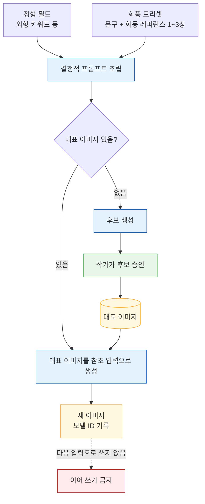

# 05. 이미지 엔진 — 일관된 캐릭터·장소·소품 이미지

이 문서는 `packages/image-engine`이 같은 캐릭터·장소·소품을 여러 이미지에 걸쳐 일관되게 그리는 방식, 공급자 구성, 이미지 파일 저장 규칙을 정리한다. 담당은 imagery 역할이고, 파일 저장소와 작업 실행은 backend와 맞물린다. 관련 결정 원본은 [ADR 이미지 일관성](../.forge/adr/261101-233441-reference-conditioned-images-gemini.md)이다.

## 대상

이미지를 갖는 설정은 **캐릭터, 장소, 소품**이다. 장소를 그린 이미지를 "배경"이라 부른다. 세계관은 이미지를 갖지 않는다. 캐릭터·장소·소품을 한 장면에 합성하는 장면 삽화는 MVP에 없다([01 제품의 아직 흐림](01-product.md#아직-흐림)).

## 일관성 방식 — 대표 이미지 레퍼런스 조건부 생성

일관성은 **레퍼런스 조건부 생성**으로 확보한다. 설정마다 작가가 승인한 **대표 이미지**를 하나 두고, 그 설정의 모든 이미지 생성 요청에 대표 이미지와 작품의 **화풍 프리셋**을 함께 넣는다.

- **화풍 프리셋** = 그림체 문구 + **화풍 레퍼런스 이미지 1~3장**. 컨셉에 속하는 작품 속성이며, 한 작품의 모든 이미지에 같은 값이 들어가 그림체를 맞춘다.
- **항상 승인된 대표 이미지에서 출발한다.** 이전 생성 결과를 다음 생성의 입력으로 이어 쓰지 않는다. 이어 쓰면 작은 변형이 누적되어 몇 단계 뒤에는 다른 인물이 된다.
- **프롬프트는 정형 필드에서 결정적으로 만든다.** 외형 키워드(머리·눈·체형·대표 의상), 장소의 시대·분위기 키워드, 소품의 외형 키워드를 같은 순서·같은 문구로 조립하고, 화풍 프리셋 문구를 앞에 고정한다.
- **시드에 의존하지 않는다.** 시드와 프리셋만으로는 자세나 표정이 바뀔 때 정체성이 유지되지 않는다. 주요 공급자 일부는 시드를 문서화하지도 않는다(2026-11-01 조사 기준).
- **캐릭터별 LoRA는 MVP에서 미룬다.** 고정력과 모델 은퇴 내성은 가장 크지만, 학습 큐와 승인된 이미지 10장 이상이 필요하다([01 제품의 아직 흐림](01-product.md#아직-흐림)).

대표 이미지가 없는 새 설정은 정형 필드와 화풍 프리셋만으로 후보를 만들고, 작가가 그중 하나를 승인하면 그것이 대표 이미지가 된다. 이후의 모든 생성은 그 대표 이미지에서 출발한다. 아래 흐름도에서 초록색은 작가의 행동이다.

## 공급자 구성

첫 공급자는 **Google Gemini 이미지 모델**이다. 공급자 호출은 **image-engine 인터페이스** 뒤에만 두어, 교체해도 나머지 코드가 바뀌지 않게 한다.

| 용도 | 모델 | 조사 기준 특성(2026-11-01, 일부 미검증) |
|---|---|---|
| 초안 | **Nano Banana 2.1** | 레퍼런스 최대 14장(캐릭터 슬롯 4), 1K 약 $0.0336 · 2K 약 $0.0504 |
| 최종 | **Nano Banana Pro** | 캐릭터 슬롯 5 · 화풍 레퍼런스 슬롯 3, 1K/2K 약 $0.134 |
| 교체 후보 | **FLUX**(BFL FLUX.2 등) | 레퍼런스 최대 8장, 시드 지원, 안전 허용치(safety_tolerance) 조정 가능, 공식 Node SDK 없음 |

- 가격과 슬롯 수는 조사 에이전트의 보고이며, 빌드 전에 공급자 문서로 다시 확인한다.
- 초안과 최종을 언제 나눠 부를지(작가가 "최종 생성"을 고르는 방식 등)는 imagery와 frontend가 정할 것이다.

## 모델 ID 기록과 모델 은퇴

**이미지마다 생성에 쓴 모델 ID를 기록한다**([03 데이터 모델의 이미지](03-data-model.md#이미지)). 호스팅 모델은 공급자 사정으로 은퇴한다. 예를 들어 Nano Banana 2는 2026-10-29에 은퇴했다(조사 기준). 모델이 바뀌면 같은 대표 이미지로도 그림체가 달라질 수 있고, 이것은 통제할 수 없다. 모델 ID 기록은 영향받는 이미지를 찾기 위한 최소 장치다. 이 위험이 실제로 문제가 되면 캐릭터별 LoRA를 다시 검토한다.

## 빌드 전 검증 — 일관성과 검열 오탐

구현에 들어가기 전에 두 가지를 실제로 시험한다. 시험 계획은 [08 제작 계획](08-build-plan.md)에 있다.

1. **일관성 시험** — 한 캐릭터의 대표 이미지로 자세·표정·의상을 바꿔 여러 장을 만들었을 때 같은 인물로 보이는가.
2. **검열 오탐 시험** — 한국 웹소설에 흔한 애니메이션풍 10대 캐릭터, 전투·폭력 묘사가 공급자 검열에 막히지 않는가. 미성년자 성적 묘사는 모든 공급자에서 차단되는 것이 정상이고, 시험 대상은 정상적인 묘사가 잘못 막히는 경우다.

Gemini가 통과하지 못하면 **image-engine 인터페이스 뒤에서 FLUX로 교체**한다.

## 이미지 파일 저장소

- 이미지 파일은 **저장소 인터페이스**(저장 · 읽기 · 삭제 · 접근 URL) 뒤에 둔다. 인터페이스는 backend가 apps/api에 정의하고, image-engine은 그 인터페이스로만 저장한다.
- 첫 구현은 **로컬 디스크**다. 배포에서는 호스트 볼륨의 이미지 디렉터리에 들어간다([02 아키텍처의 배포 구성](02-architecture.md#배포-구성)).
- 이미지는 작가 소유의 비공개 자원이다. 정적 경로로 공개하지 않고, **api가 요청한 작가의 권한을 확인한 뒤** 내려준다.
- 나중에 S3 호환 스토리지로 옮길 때는 인터페이스 구현만 바꾸고, 접근 URL 자리에서 서명 URL을 발급한다.
- SQLite BLOB으로 저장하지 않는다. DB 파일이 부풀고 DBMS 이전이 무거워진다.
- 배포를 휘발성 디스크 환경으로 바꾸게 되면 이 결정을 다시 연다.

이미지 생성은 수십 초가 걸릴 수 있어 긴 작업으로 처리한다(SQLite 작업 테이블 + 워커, [02 아키텍처](02-architecture.md#ai-작업-실행-방식)).

## imagery가 정할 것

- 정형 필드 → 프롬프트 변환 문구와 순서, 해상도·비율.
- 화풍 레퍼런스 이미지를 작가가 등록하는 방식(업로드 또는 생성 후 승인)과 frontend 화면 연동.
- 공급자 오류·검열 차단 시 작업 상태와 작가에게 보여 줄 메시지(backend와 함께).
