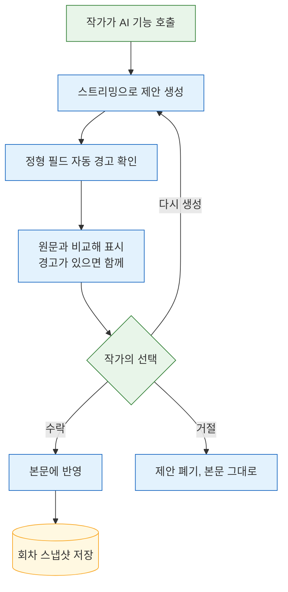

# 06. 에디터와 AI 협업 UX

이 문서는 작가가 에디터 안에서 AI와 함께 쓰는 방식, AI 제안을 본문에 반영하는 규칙, 회차 스냅샷, 그리고 에디터 라이브러리를 고르는 한국어 IME 스파이크를 정리한다. 담당은 frontend 역할이다. 관련 결정 원본은 [ADR 에디터](../.forge/adr/261101-233610-editor-ime-spike-gate-block-json.md)다.

## 화면 구성

frontend가 만드는 화면은 다음과 같다. 화면 배치와 시각 디자인은 frontend가 정할 것이다.

- **작품 목록** — 작가 자신의 작품만 보인다.
- **회차 에디터** — Notion식 블록 에디터와 사이드 AI 패널. 이 문서의 대부분이 이 화면에 관한 것이다.
- **설정 화면** — 캐릭터·장소·소품·세계관의 정형 필드 폼과 설정 본문 블록 에디터([03 데이터 모델](03-data-model.md#설정-종류와-고정-필드)).
- **작품 컨셉·시놉시스 화면** — 장르·톤·서술 시점·타깃 독자·화풍 프리셋, 시놉시스 문서.
- **이미지 갤러리** — 설정별 이미지, 대표 이미지 승인([05 이미지 엔진](05-image-engine.md)).
- **자료 화면** — 저장한 자료와 출처([07 자료 조사](07-research.md)).

## AI 협업 방식

에디터에서 AI를 부르는 방식은 네 가지이며 **모두 MVP에 들어간다**.

| 방식 | 작가의 행동 | AI 기능 |
|---|---|---|
| 선택 영역 메뉴 | 문장을 선택하면 뜨는 메뉴에서 고른다 | 다시쓰기, 문체 다듬기, 늘리기·줄이기 |
| "/" 명령 블록 생성 | 빈 줄에서 `/이어쓰기`, `/초안`을 입력한다 | 이어쓰기, 회차 초안(플롯 메모 기반) — 결과가 스트리밍으로 들어온다 |
| 사이드 AI 패널 | 본문 옆 패널에서 대화한다 | 줄거리 구상, 자료 조사, 설정에 관한 질의 |
| ghost text | 입력을 멈추면 커서 뒤에 흐린 제안이 뜬다 | 한 문장 이내 이어쓰기 제안, Tab으로 수락 |

각 기능이 AI에 무엇을 넘기는지는 [04 스토리 엔진](04-story-engine.md#텍스트-기능별-동작)에 있다. 사이드 패널의 대화는 저장만 하고 AI 컨텍스트에는 넣지 않으며, 확정 내용은 작가가 "시놉시스에 넣기", "플롯 메모에 넣기", "자료로 저장"으로 옮긴다.

## AI 제안과 수락

AI가 만든 본문 변경은 모두 **AI 제안**이다. AI 제안은 **작가가 수락하기 전까지 본문에 반영되지 않는다.** 선택 영역 다시쓰기나 `/초안`은 몇 문단을 한 번에 바꾸는데, 바로 덮어쓰면 원문과 비교할 수 없고 에디터의 되돌리기 기록은 새로고침하면 사라지기 때문이다.

- 제안은 원문과 비교해 보여 준다(취소선과 새 문장, 또는 나란히). 표시 방식은 에디터 라이브러리의 제안 기능에 맞춰 frontend가 정할 것이다.
- 작가는 **수락**, **거절**, **다시 생성** 중 하나를 고른다.
- 제안에 설정 충돌 자동 경고(사망·행방불명 캐릭터 등장)가 붙어 있으면 함께 보여 준다. 경고는 수락을 막지 않는다([04 스토리 엔진](04-story-engine.md#설정-충돌-검사)).
- ghost text는 원래 Tab 수락 방식이라 이 원칙과 충돌하지 않는다. 무시하고 계속 입력하면 사라진다.

AI 제안 하나가 생성되어 처리되기까지의 흐름은 아래와 같다. 초록색은 작가의 선택이다.



## 회차 스냅샷과 복원

- **AI 제안을 수락한 시점**과 **주기적 자동 저장** 때 회차 본문 전체를 **회차 스냅샷**으로 남긴다.
- 작가는 스냅샷 목록에서 특정 시점을 골라 **복원**할 수 있다. MVP는 시점 복원만 제공한다.
- 두 스냅샷을 나란히 비교하는 diff 화면은 미룬다.
- 본문은 텍스트라 SQLite에 스냅샷을 쌓아도 부담이 작다. 자동 저장 주기와 스냅샷 보존 개수는 frontend와 backend가 정할 것이다.

## 에디터 라이브러리 — 한국어 IME 스파이크로 결정

에디터 라이브러리는 문서 비교가 아니라 **실측으로** 정한다. 한국어 소설 집필에서 가장 자주 누르는 키는 Enter인데, Enter 때 마지막 음절이 사라지는 버그가 일부 후보에 열려 있고, 최신 버전에서 재현되는지는 문서만으로 알 수 없다. 그래서 **BlockNote**와 **Plate**를 하루짜리 한국어 **IME 스파이크**로 시험한다.

### 결정 규칙

```
두 후보 시험 → 하나만 통과 → 그것을 채택
             → 둘 다 통과 → Plate 채택
             → 둘 다 실패 → Lexical 검토
```

둘 다 통과할 때 **Plate**를 고르는 이유는 선택 영역 AI 메뉴, "/" 생성, ghost text, 수락·거절 제안 모드가 모두 MIT 라이선스로 들어 있기 때문이다. BlockNote의 AI 패키지는 GPL-3.0이거나 유료(월 $195)다. **Lexical**은 한국어 IME 수정이 가장 활발하지만 Notion식 UI와 AI 기능을 모두 직접 만들어야 한다.

### 조사 근거 (2026-11-01 조사 에이전트 보고, 일부 미검증)

| | BlockNote 0.57 | Plate(platejs 53) | Lexical 0.53 |
|---|---|---|---|
| Notion식 UI | 기본 제공 | 기본 제공(복사형 컴포넌트) | 직접 구현 |
| 선택 영역·"/" AI, 스트리밍 | 기본 제공(xl-ai) | 기본 제공 | 직접 구현 |
| ghost text | 직접 구현 | 기본 제공(Copilot, Tab 수락) | 직접 구현 |
| 수락·거절 제안 | 기본 제공 | 기본 제공(제안 모드) | 직접 구현 |
| 라이선스 | 핵심 MPL-2.0, AI 패키지 GPL-3.0 또는 유료 | 전부 MIT | MIT |
| 한국어 IME 위험 | Enter 시 마지막 음절 사라짐(BlockNote #1679, 하위 Tiptap #4108 열림) | 열린 한국어 이슈 없음, Slate IME 수정이 2026-10에 반영됨, 내부 엔진 교체 진행 중 | 한국어 수정 다수, 일부 이슈 열림 |

Plate를 채택하면 내부 엔진 교체가 진행 중이므로 스파이크에서 쓴 버전을 고정한다.

### 스파이크 시험 매트릭스

각 후보를 아래 환경 조합에서 아래 항목으로 시험한다. 한 칸이라도 입력이 깨지면 그 후보는 실패다.

| 환경 | 입력기 |
|---|---|
| macOS × Chrome · Safari · Firefox · Edge | macOS 두벌식 |
| Windows × Chrome · Firefox · Edge | Microsoft 한글 IME |

| 시험 항목 | 통과 조건 |
|---|---|
| 조합 중 Enter | 마지막 음절이 사라지거나 중복되지 않는다 |
| 조합 중 Backspace | 조합이 취소되지 않고 한 자모씩 지워진다 |
| 조합 중 마우스 클릭 | 글자가 중복·소실되지 않는다 |
| "/" 메뉴에서 한글 입력 | 메뉴 필터링과 선택이 정상 동작한다 |
| 커서 옆 ghost text | 제안이 떠 있는 상태에서 한글을 입력해도 조합이 깨지지 않는다 |

시험은 frontend가 맡고, 결과와 채택 라이브러리는 [08 제작 계획](08-build-plan.md)의 스파이크 결과로 기록한다.

## ghost text 표시 규칙

커서 바로 옆에 위젯을 그리는 것은 IME 조합을 깨뜨리는 알려진 원인이다. 그래서 ghost text는 아래 규칙으로 구현한다.

- **한글 조합 중에는 ghost text를 숨긴다.** 조합이 시작되면 표시를 감추고(DOM을 지우기보다 CSS로 숨기는 방식을 우선 검토), 조합이 끝난 뒤 다시 판단한다.
- 호출 자체도 조합이 끝난 상태에서만 한다([04 스토리 엔진의 ghost text](04-story-engine.md#ghost-text)).
- 작가별 켜기·끄기 설정을 에디터 설정에 둔다.

## 저장 포맷

- 회차 본문과 설정 본문의 저장 원본은 **에디터 라이브러리의 블록 JSON**이다.
- 저장할 때마다 **일반 텍스트와 Markdown**을 파생해 함께 저장한다. AI 입력과 회차 스냅샷에는 파생본을 쓴다.
- Markdown을 원본으로 하지 않는다. 대기 중인 AI 제안과 블록 메타 정보를 담을 수 없기 때문이다.
- AI 출력은 Markdown이나 블록으로 받아 AI 제안으로 적용한다.

## 한국어 웹폰트

한국어 웹폰트는 **Pretendard 정적 빌드**를 쓴다. 동적 서브셋 빌드는 Chromium에서 조합 중 커서 위치를 어긋나게 한다는 보고가 있다(Lexical #4753, 조사 기준). 이 문제는 에디터 라이브러리와 무관하게 모든 후보에 영향을 준다.
