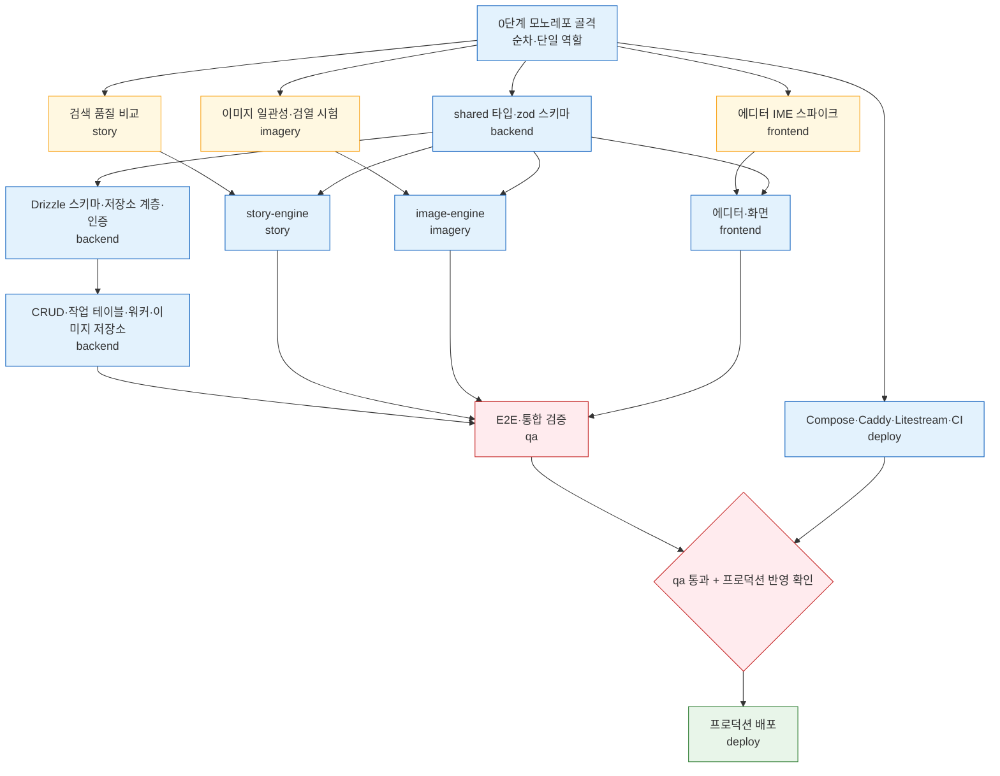

# 08. 제작 계획 — 검증 스파이크와 역할별 첫 작업

이 문서는 MVP 첫 빌드를 어떤 순서로 진행할지 정리한다. 먼저 결정을 뒤집을 수 있는 **검증 스파이크 3개**를 하고, 그 결과를 반영해 역할별 첫 작업에 들어간다. 역할 정의는 `.agents/teams/orchestrator.json`을 따른다.

| 역할 | 담당 폴더 | 이 계획에서 맡는 일 |
|---|---|---|
| frontend | `apps/web` | 에디터 IME 스파이크, 집필 화면 |
| backend | `apps/api`, `packages/shared` | 공용 타입, DB 스키마, 인증, CRUD, 작업 테이블, 이미지 저장소 |
| story | `packages/story-engine` | 검색 품질 비교, 텍스트 생성 파이프라인 |
| imagery | `packages/image-engine` | 이미지 일관성·검열 오탐 시험, 이미지 생성 엔진 |
| qa | `tests`(별도 qa 워크스페이스) | 핵심 흐름 E2E·통합 테스트 |
| deploy | `infra`, `.github/workflows` | 컨테이너·백업·CI, 운영 설정 |

## 0단계 — 모노레포 골격

루트 `package.json`, lockfile, `tsconfig`, pnpm workspace 설정은 어느 역할의 폴더에도 속하지 않는다. 여러 역할이 동시에 의존성을 추가하면 lockfile이 충돌하므로, **골격은 다른 작업을 병렬로 시작하기 전에 한 번에 순서대로** 깐다. 오케스트레이터가 이 작업을 한 역할에 맡긴다. 골격에는 [02 아키텍처의 저장소 구조](02-architecture.md#저장소-구조와-역할)에 나온 apps·packages 디렉터리와 빈 패키지 설정이 포함된다.

## 1단계 — 빌드 전 검증 스파이크

아래 세 시험은 결과에 따라 결정이 바뀔 수 있어서 본 구현보다 먼저 한다. 서로 독립적이므로 골격 이후 병렬로 진행할 수 있다.

| 스파이크 | 담당 | 무엇을 시험하나 | 통과 조건 | 결과에 따라 바뀌는 것 |
|---|---|---|---|---|
| 에디터 한국어 **IME** 스파이크 | frontend | BlockNote와 Plate를 macOS·Windows × 주요 브라우저 × 두벌식·MS 한글 IME로 시험 | [06 에디터의 시험 매트릭스](06-editor-and-ai-ux.md#스파이크-시험-매트릭스) 전 항목에서 입력이 깨지지 않음 | 에디터 라이브러리(하나만 통과 → 그것, 둘 다 → Plate, 둘 다 실패 → Lexical 검토) |
| 이미지 **일관성**·**검열** 오탐 시험 | imagery | Gemini(Nano Banana 2.1·Pro)로 한 캐릭터의 대표 이미지에서 자세·표정·의상 변형 여러 장 생성, 애니메이션풍 10대 캐릭터·전투 묘사 생성 | 같은 인물로 보임(사람 판정), 정상 묘사가 검열에 막히지 않음 | 이미지 공급자(실패 시 FLUX로 교체) — [05 이미지 엔진](05-image-engine.md#빌드-전-검증--일관성과-검열-오탐) |
| 자료 조사 한국어 **검색 품질** 비교 | story | 실제 한국어 조사 질문 20~30개를 Claude `web_search`와 Tavily로 답하게 하고 점수 비교 | Claude 검색이 크게 뒤지지 않음 | 검색 백엔드(크게 뒤지면 Tavily로 교체) — [07 자료 조사](07-research.md#빌드-전-검증--한국어-검색-품질-비교) |

- 각 시험의 세부 판정 방법(점수 기준, 표본 수, "크게 뒤진다"의 기준)은 담당 역할이 시험 계획에 정하고, 결과를 오케스트레이터에 보고한다.
- 결과로 결정이 바뀌면 해당 문서와 `.forge/agenda.md` 쪽 결정 기록을 함께 고친다.

## 2단계 — 역할별 첫 빌드 작업

아래 작업은 모두 앞선 결정에서 직접 나온 것이다. 세부 설계(엔드포인트 경로, 컬럼 타입, 프롬프트 문구 등)는 각 역할이 정한다.

### backend

- `packages/shared`: API 요청·응답 zod 스키마와 타입의 골격. web과 엔진이 이것에 맞춰 개발하므로 가장 먼저 낸다.
- Drizzle 스키마와 마이그레이션: [03 데이터 모델](03-data-model.md)의 엔티티, 이식성 규칙(저장소 계층 경유, SQLite 전용 기능 금지, 문자열 ULID/UUID, 시간 형식 통일) 준수.
- 인증: 이메일+비밀번호, 관리자 발급 초대 코드 가입, 관리자 비밀번호 재설정, 작가별 소유권 확인.
- 작품·회차·설정·자료·스냅샷 CRUD, 블록 JSON 저장 시 일반 텍스트·Markdown 파생 저장.
- SQLite 작업 테이블과 api 프로세스 내 워커.
- 이미지 저장소 인터페이스(로컬 디스크 구현)와 권한 확인 후 이미지 제공.
- AI 사용 기록 저장.

### story

- Claude 호출용 얇은 내부 인터페이스(생성·스트리밍), 상위·하위 모델 구성.
- 컨텍스트 조립기([04 스토리 엔진의 컨텍스트 조립 규칙](04-story-engine.md#컨텍스트-조립-규칙)).
- 이어쓰기·다시쓰기·문체 다듬기·늘리기/줄이기·회차 초안의 SSE 스트리밍 생성.
- ghost text 생성(한 문장 이내, 하위 모델).
- 정형 필드 기반 자동 충돌 경고와 "설정 점검".
- 회차 완료 처리(회차 요약 + 정형 필드 변경 후보).
- 자료 조사(`web_search`·`web_fetch`, 네이버 출처 차단).

### imagery

- image-engine 인터페이스와 Gemini 연동(검증 스파이크 결과 반영).
- 정형 필드 → 결정적 프롬프트 조립, 화풍 프리셋 고정.
- 대표 이미지 참조 생성, 이전 결과물 이어 쓰기 금지, 모델 ID 기록.
- 저장은 backend의 저장소 인터페이스로만.

### frontend

- 검증 스파이크에서 채택한 에디터로 회차 에디터와 설정 본문 에디터.
- 선택 영역 메뉴, "/" 명령, 사이드 AI 패널, ghost text(조합 중 숨김).
- AI 제안 비교·수락·거절·다시 생성 UI, 회차 스냅샷 목록과 복원.
- 작품 목록, 설정 화면, 컨셉·시놉시스 화면, 이미지 갤러리, 자료 화면.
- Pretendard 정적 빌드 적용.

### qa

- 핵심 흐름 E2E: 초대 코드 가입 → 작품 생성 → 설정 작성 → 회차 작성과 AI 제안 수락 → 회차 완료 처리 → 대표 이미지 승인과 이미지 생성.
- 엔진·api 통합 테스트(컨텍스트 조립 규칙, 권한 확인, 작업 상태 전이).
- 커밋된 코드만 별도 qa 워크스페이스에서 검증하고, 실패하면 재현 절차를 붙여 오케스트레이터에 보고.

### deploy

- Docker Compose(Caddy + api), 호스트 볼륨, api 단일 인스턴스 구성.
- Litestream으로 SQLite 지속 복제, 이미지 디렉터리 주기 동기화, 복구 절차 점검.
- CI 파이프라인, 환경 변수·시크릿 연결(서비스 키).
- 운영 작업: 공급자 콘솔 월 지출 한도 설정.

## 의존 순서

작업은 골격 → 스파이크 → 공용 타입·DB 스키마 → 엔진·api·화면 → qa 검증 → 배포 순서로 흐른다. 스파이크 3개와 deploy의 인프라 준비는 서로 독립이라 병렬로 진행할 수 있다. 아래 흐름도에서 노란색은 결정을 바꿀 수 있는 검증 단계, 빨간색은 사람 확인이 필요한 관문이다.



## qa 흐름과 배포 관문

frontend·backend·story·imagery·deploy는 하나의 공유 워크스페이스에서 작업하고, qa만 별도 워크스페이스에서 검증한다. 공유 워크스페이스에서 수정 중인 파일이 아니라 **커밋된 상태**를 검증해야 결과를 재현할 수 있기 때문이다. 그래서 각 역할은 작업 단위마다 커밋하고, qa에는 검증할 커밋이나 브랜치를 지정해 넘긴다.

```
역할이 작업 단위 커밋 → qa 워크스페이스가 받아 검증 → 통과 → deploy가 프로덕션 반영 전 확인 요청
                                         ↓ 실패
                         재현 절차를 붙여 오케스트레이터에 보고 → 담당 역할 수정
```

- deploy는 프로덕션 배포 전에 qa 통과를 확인한다.
- 프로덕션 반영, 되돌리기, 인프라 철거처럼 되돌릴 수 없는 작업은 오케스트레이터 확인을 거친다.
- qa가 쓴 `tests/` 변경은 qa 워크스페이스 브랜치에 생기므로 main에 합치는 단계가 따로 필요하다.
